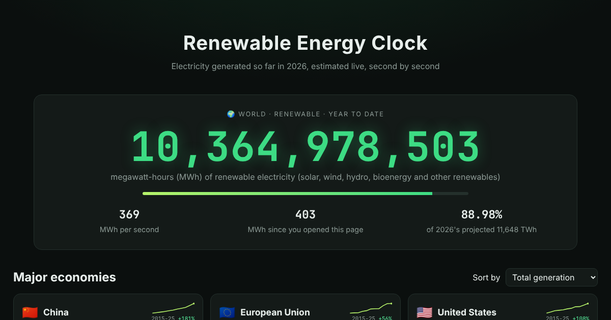

# Renewables Clock



**Live site: https://ramialbatal.github.io/renewables-clock/**

A static, real-time clock estimating **renewable electricity** generated so far this year for the world and major economies.
A switch at the top changes source: all renewables, solar, wind or hydro. `#solar`, `#wind` or `#hydro` in the URL opens that view directly.
It is the companion to the [Emissions Clock](https://ramialbatal.github.io/emissions-clock/) and uses the same method.

## Data

On load, the page fetches yearly electricity generation by source from
[Our World in Data's grapher API](https://ourworldindata.org/renewable-energy) (chart `electricity-mix`, by source),
which combines Ember's yearly electricity data and the Energy Institute's Statistical Review of World Energy.
The full table is downloaded (about 150 KB compressed) because the filtered download drops years with any blank cell.

Sources, countries, the trend window, the growth cap and the capacity goal are configured in `js/config.js`.

## Goal: tripling renewables by 2030

A goal section tracks the COP28 pledge to triple renewable capacity to at least 11,000 GW by 2030 (from the 2022 level).
Installed capacity (IRENA, end-of-year GW, excluding pumped storage) comes from Our World in Data's indicator API
(`api.ourworldindata.org/v1/indicators/1305907`). The bar shows capacity now (latest year extended at its latest growth)
against the target, with a marker for where an even compound path from 2022 would be today. Each country card in the
*All* view applies the same test to tripling its own 2022 capacity, as a rough guide only.

## Method

The latest reported year is projected to the current year using each country's latest year-on-year change,
capped at 50% a year so tiny fast-growing bases don't run away. That total is spread evenly across the year,
so the counters show year-to-date generation ticking in real time. This is a model, not a live measurement.

## Run it and check it

```sh
npm run serve        # then open http://localhost:8000
npm install          # dev tools only: TypeScript checker, Playwright, clock-core (types and tests)
npm run check        # house style + types + unit tests
npm run smoke        # real browser, real data, desktop and phone
```

Settings live in `js/config.js`, calculations in `js/model.js` (unit tested), page code in `js/app.js`. Shared helpers
and styles come from [clock-core](https://github.com/ramialbatal/clock-core), pinned to a release in `index.html`.
How the clocks are built, lessons learned and rules for new code: [developer notes](https://github.com/ramialbatal/clock-core/tree/main/docs).

## Contributing

Ideas, fixes and new data sources are welcome: see [CONTRIBUTING.md](CONTRIBUTING.md). Part of
[AI for things that matter](https://ramialbatal.github.io/), alongside the
[Emissions](https://github.com/ramialbatal/emissions-clock), [Renewables](https://github.com/ramialbatal/renewables-clock)
and [Jobs](https://github.com/ramialbatal/jobs-clock) clocks.

## Licence

Code: [MIT](LICENSE). Data is fetched live from its publishers and stays under their licences:

| Source | Used for | Licence |
|---|---|---|
| Ember, Yearly electricity data | electricity generation by source | CC BY 4.0 |
| Energy Institute, Statistical Review of World Energy | combined with Ember by Our World in Data | see the source's terms |
| IRENA, Renewable Energy Statistics | installed renewable capacity | see the source's terms |
